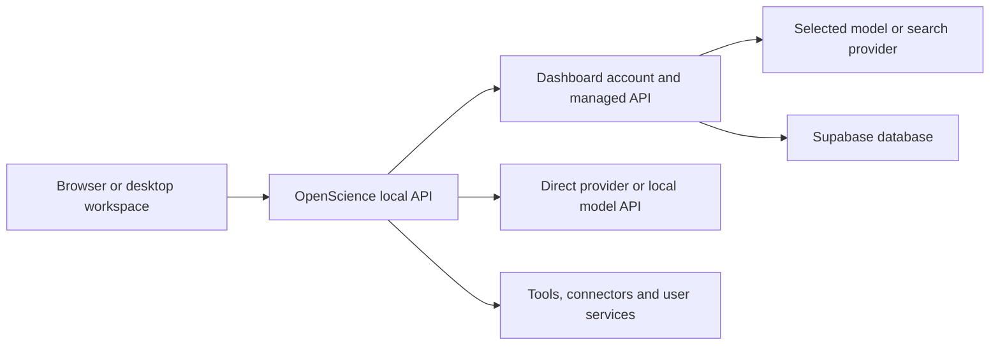

# OpenScience API calls and latency

Inventory date: 26 October 2026. Source: OpenScience `187e99311cb530dcd6a3c3d8d691f6600d150a69`; Dashboard follow-up `fd8f42dc08cade41fe218adb7f41ae3d4a9ca0f3`. These performance changes are in draft PRs, not a new release.

This document maps the requests the current source can make. A normal task uses only part of this map. Scientific tools, account settings, sign-in and updates add calls when you use those features.

The local baseline shows slow database round trips in account calls. On the isolated Fly test API, all 66 profiled reads completed within their comparison bounds. Normal forced sync completed in 2.05–2.74 seconds. This is a small staging sample, not proof of production capacity. Provider inference time and managed gateway time still need separate measurements.

Read the [baseline timings](#account-and-usage-baseline-25-october-2026), [latest results](#follow-up-26-october-2026), and [known causes](#what-caused-the-delays) first. The remaining sections list [Dashboard calls](#dashboard-api-calls), [local calls](#local-api-calls), model providers, scientific connectors, tools and updates.

A **target** is a proposed engineering goal. It is not a provider SLA or a measured minimum. **Not measured** means that we do not have a recorded sample for that operation. A timeout is a limit, not a target and not a successful latency result.

## Call layers

The browser normally calls the OpenScience server. The server calls Dashboard and the model provider. Supabase is a downstream Dashboard dependency. A slow local endpoint can therefore contain a slow remote call. Do not add both durations as separate work when one contains the other.

Target codes in the inventory refer to the target table below.

Default Dashboard origin: `https://app.syntheticsciences.ai`. Test and private deployments can replace it. Source: [endpoint resolver](../../backend/cli/src/endpoints.ts).

Streaming calls need separate measurements: response headers, first body byte, first text token, and full response. An open event stream does not have a useful “full response” latency.

## Latency targets and measured results

There is no single proven “optimal latency” for every API. A model request, a database read and a file download have different costs. The values below are **proposed engineering targets**, not provider promises, measured best cases or accepted product requirements. They assume warm connections, small normal payloads, a healthy service, and an API placed near its database. A user far from that API pays additional network travel time.

“Usual” is the proposed median target. “p95” means 95% of requests should finish within that time. We have not measured a reliable p95. Targets do not change existing timeouts or authorization checks.

| Code | Call class                                                |         Proposed usual target |           Proposed p95 target | Measurement boundary                                                                   |
| ---- | --------------------------------------------------------- | ----------------------------: | ----------------------------: | -------------------------------------------------------------------------------------- |
| L    | Local API read or small write                             |                         50 ms |                        200 ms | Client request to complete response, excluding work it starts                          |
| R    | Remote account, balance, catalog, receipt or version read |                        300 ms |                           1 s | Complete small response; includes authorization                                        |
| S    | Full credential sync                                      |                           1 s |                           3 s | Complete validated client refresh; forced refresh should make one payload request      |
| M    | Managed model request                                     | 300 ms added gateway overhead |    1 s added gateway overhead | Excludes provider queue, inference and stream duration; no universal model TTFT target |
| T    | Tool or connector                                         | 1 s for a small metadata call | 3 s for a small metadata call | Search, downloads, compute and long-running jobs require separate per-tool targets     |
| B    | Background consent / trace batch                          |   Consent: 300 ms; batch: 1 s |      Consent: 1 s; batch: 2 s | Remote acknowledgement; queue delay is a separate metric                               |
| I    | Sign-in / authorization API leg                           |                           1 s |                           2 s | Excludes time for the user to approve sign-in                                          |

A UI response that starts a long-running task can meet L while the task continues. Keep separate measurements for task completion. Event streams and terminals remain open, so their connection duration is not a normal response-latency metric.

### Account and usage baseline: 25 October 2026

This is the most complete measured endpoint set. It contains **55 successful HTTP requests**: eleven endpoints, with one first pass, two warm sequential samples, one concurrency-three sample and one local HTTP sample per endpoint. “Warm median” is the median of only two observations. It does not establish a production median or tail percentile.

The ASGI path runs the actual Dashboard handlers and authentication against the Supabase test branch. It skips application startup jobs and migrations. The local HTTP path uses a separately running API. Do not subtract those columns to estimate network time: they are separate, non-paired runs. The diagnostic permits 45 seconds to observe completion. Existing client limits still apply.

| Endpoint / reader                                             | Target | Warm ASGI median | Concurrent sample | Local HTTP sample | Warm SQL statements | Existing client / profile bound  |
| ------------------------------------------------------------- | ------ | ---------------: | ----------------: | ----------------: | ------------------: | -------------------------------- |
| GET `/api/auth/status` — Dashboard UI comparison              | R      |           2.10 s |            2.08 s |            2.02 s |                 2,2 | 5 s                              |
| GET `/api/v1/auth/status` — OpenScience                       | R      |           5.12 s |           11.80 s |            7.49 s |                 6,6 | 15 s account read                |
| GET `/api/account-context` — Dashboard UI comparison          | R      |           4.49 s |           11.44 s |            6.23 s |                 5,5 | 8 s Dashboard bootstrap          |
| GET `/api/cli/balance`                                        | R      |           3.60 s |            3.45 s |            7.58 s |                 5,5 | 15 s account read                |
| GET `/api/cli/model-catalog`                                  | R      |           2.53 s |            2.54 s |           11.86 s |                 3,3 | 15 s profile / caller-dependent  |
| GET `/api/credits/usage`                                      | R      |           5.10 s |            5.25 s |           12.84 s |                 8,8 | 15 s account route               |
| GET `/api/organizations/{id}/usage` — Dashboard UI comparison | R      |           6.45 s |            9.58 s |            8.38 s |                 8,8 | 30 s Dashboard read              |
| POST `/api/credits/call-receipts`                             | R      |           2.53 s |            3.57 s |            3.17 s |                 3,3 | 5 s per batch of up to 128 calls |
| GET `/api/v1/telemetry/health`                                | R      |           5.15 s |            5.14 s |           14.97 s |                 6,6 | 15 s account deadline            |
| GET `/api/cli/sync/version`                                   | R      |           8.65 s |           14.85 s |           13.80 s |               13,13 | Shared 15 s sync deadline        |
| GET `/api/cli/sync`                                           | S      |           9.61 s |            9.74 s |           16.46 s |               15,15 | Shared 15 s sync deadline        |

SQL counts include transaction control, but exclude connection setup/reset. The two repeated warm counts show both samples, not their sum. Dashboard-only comparison rows are not additional CLI calls. The catalog profile bound is a diagnostic comparison value; it is not a claim that all catalog callers use that timeout.

Source: [redacted observations](data/openscience-api-latency-2026-10-26.json), [Dashboard findings](https://github.com/synthetic-sciences/dashboard/blob/fd8f42dc08cade41fe218adb7f41ae3d4a9ca0f3/docs/ACCOUNT_READ_LATENCY_2026-10-25.md), and [profiler endpoint definitions](https://github.com/synthetic-sciences/dashboard/blob/fd8f42dc08cade41fe218adb7f41ae3d4a9ca0f3/backend/scripts/profile_account_reads.py). The existing source implementations remain authoritative for individual deadlines.

### Follow-up: 26 October 2026

These observations use OpenScience `187e9931` and Dashboard `fd8f42dc`. They are a separate run, after the sync fixes. They are not a repeated baseline of all eleven endpoints.

**Normal forced sync:** one pass completed in 14.95 s and a warm pass in 7.81 s, with the normal 15-second limit. A later preflight timed out. The server logged that abandoned request returning headers after 24.46 s; this is not a successful client refresh. A later retry allowed the managed task to start. Reliable sync latency is still unproven.

The next table records the server middleware's time until response headers. For streaming requests, it stops before the stream is consumed. For JSON requests, it still excludes final client transfer and parsing. These are **not model time-to-first-token (TTFT) or complete-answer measurements**. The logger records requests for which its handler returns a response; exceptions can be absent. Its successful samples must not hide the client's errors.

| Endpoint                                        | Returned-header samples |  Observed range | Observed sample median | Result and limit                                                                                          |
| ----------------------------------------------- | ----------------------: | --------------: | ---------------------: | --------------------------------------------------------------------------------------------------------- |
| `/api/health`                                   |                       1 | 0.001 s–0.001 s |                0.001 s | 200; cheap readiness route, not a database or Wallet health check.                                        |
| `/api/cli/sync`                                 |                       4 |  7.78 s–24.46 s |                11.63 s | 200 at server; one response came after the client deadline.                                               |
| `/api/cli/model-catalog`                        |                       2 |   3.17 s–4.22 s |                 3.69 s | 200; still multiple database round trips.                                                                 |
| `/api/cli/balance`                              |                       3 |   3.17 s–4.65 s |                 4.22 s | Successful samples only; the client also received three HTTP 500 responses.                               |
| `/api/v1/auth/status`                           |                       3 |  5.56 s–12.42 s |                 7.57 s | 200; authentication / account reads remained slow.                                                        |
| `/api/llm/proxy/openrouter/v1/chat/completions` |                       4 | 18.23 s–24.17 s |                20.99 s | Four HTTP 200 calls; also four HTTP 500 responses and one test-guard 400. Provider time was not isolated. |
| `/api/v1/telemetry/consent`                     |                       6 |  4.44 s–10.38 s |                 5.32 s | These 200 headers arrived after the 3 s client deadline. Later client attempts also received HTTP 500.    |
| `/api/credits/call-receipts`                    |                       6 |   2.33 s–3.70 s |                 2.82 s | Successful samples only; the client also received HTTP 500. One settled charge was missing its call link. |
| `/api/v1/telemetry/health`                      |                       1 |   8.17 s–8.17 s |                 8.17 s | 200, but report status was `no_data`, not `healthy`.                                                      |

Only these successful-header sample counts have timing data in this run. The saved client status list also contains failures for `/api/v1/wallet` and `/api/cli/access`; no trustworthy duration is saved for those failures. There is no verified latency for telemetry batch upload: consent prevented delivery.

The real worker completed, but its parent failed. The eight-request test guard was exhausted and was not reset. Thirty queued trace events had no verified delivery before the test opted out. Wallet settlement recorded four debits totaling USD 0.000627; the task lookup returned three receipts totaling USD 0.000604. One settled USD 0.000023 charge had no call link. This is a tracking gap; a quick or HTTP 200 receipt response does not prove a complete cost report.

Source: [saved follow-up timings and status counts](data/openscience-api-latency-2026-10-26.json) and [local acceptance record](traces-usage-cost-local-acceptance.md#account-sync-performance-follow-up--2026-10-26).

### Fly test API: 26 October 2026

Dashboard `a32f5b901cc692cbe5ac6b32486ceb92d1228c15` ran in Fly Singapore (`sin`), connected to the Supabase test branch in AWS Mumbai (`ap-south-1`). One API worker used a primary pool of 1–3 and an OAuth pool of 1. Other local test APIs retained their connections. These settings fit the shared 15-session limit; they do not prove production capacity.

All **66 read requests returned HTTP 200**: eleven first reads, three warm reads per endpoint, eleven scheduled reads with concurrency set to **one**, and eleven HTTP reads over Fly loopback. The scheduled phase is labelled `concurrent` by the script; this run did not exercise simultaneous requests. The first pass follows pool startup and is not a cold database test. The profiler enforces read-only database sessions and can suppress optional write-on-read housekeeping. It is a diagnostic, not normal-client acceptance.

| Reader                | Warm ASGI median (3 samples) | Loopback HTTP (1 sample) | Warm SQL count |
| --------------------- | ---------------------------: | -----------------------: | -------------: |
| `dashboard_auth`      |                       240 ms |                   425 ms |              2 |
| `native_auth`         |                       600 ms |                  1330 ms |              6 |
| `workspace_bootstrap` |                       540 ms |                   721 ms |              5 |
| `balance`             |                       421 ms |                   594 ms |              5 |
| `model_catalog`       |                       302 ms |                   448 ms |              3 |
| `native_usage`        |                       601 ms |                   846 ms |              8 |
| `dashboard_usage`     |                       721 ms |                   952 ms |              8 |
| `receipts`            |                       303 ms |                   362 ms |              3 |
| `logging_health`      |                       604 ms |                   841 ms |              6 |
| `sync_version`        |                      1016 ms |                  1554 ms |             13 |
| `sync`                |                       838 ms |                  1127 ms |             10 |

Warm `SELECT 1` took about **60 ms**, compared with about **500 ms** in the earlier local profile. Query execution, checkout setup and connection reset still require round trips. This supports network travel time as a major cause. Code and placement both changed between the baseline and this run, so the comparison does not isolate the effect of either change. Neither run measured production p95.

Normal OpenScience `187e9931` forced sync made one payload request and completed in **2.503 s** and **2.046 s** against this Fly version. A fresh installation completed sync in **2.745 s** after the test backend advanced to `489af6b1`. The existing 15-second client deadline was not changed. These are end-to-end client observations, separate from the in-process and loopback samples.

The first Fly managed test also exposed two PostgreSQL serialization failures after the provider response. They left two holds pending. The candidate now retries the same generation attachment and settlement work, without sending another model request. The failed run remains evidence. See the [acceptance record](traces-usage-cost-local-acceptance.md) for the outcome of the separate bounded retest.

Source: [redacted request timings](data/openscience-api-latency-2026-10-26.json). These readings do not measure provider first-token time or establish a settled charge.

### Managed calls on the Fly test API

Five successful model requests on Dashboard `489af6b1` provide an initial
stage breakdown. They include small internal calls and parent/worker calls,
so they are not a homogeneous performance sample.

| Measurement                              | Observed range (5 calls) | Meaning                                                                                                     |
| ---------------------------------------- | -----------------------: | ----------------------------------------------------------------------------------------------------------- |
| API start to upstream dispatch           |            1.366–2.878 s | Cumulative gateway preparation, including authentication, authorization, hold/link admission and other work |
| Upstream dispatch to upstream headers    |            0.369–6.945 s | Provider/network wait for response headers; not a pure inference or first-text-token measure                |
| Local client request to response headers |           3.025–10.223 s | Includes client-to-Fly travel and gateway/upstream work                                                     |
| Local client full request                |           3.123–10.287 s | Includes streamed output; small calls have different output sizes                                           |

The existing managed preparation still exceeds the proposed 300-ms usual
overhead target in these samples. The timings identify where to profile next;
they do not isolate a new unnecessary delay. Post-response settlement is a
separate operation and is not measured by the cumulative response headers.
See the [five redacted timing records](data/usage-staging-acceptance-2026-10-26.json).
Further performance changes remain a separate feature task.

### What caused the delays?

| Finding                                                         | Evidence                                                                                                                      | What we can conclude                                                                                                  | What remains unknown                                                                                                                                       |
| --------------------------------------------------------------- | ----------------------------------------------------------------------------------------------------------------------------- | --------------------------------------------------------------------------------------------------------------------- | ---------------------------------------------------------------------------------------------------------------------------------------------------------- |
| Each database round trip is expensive                           | Warm session-pool `SELECT 1`: 511 and 503 ms. Direct connection: 639 and 563 ms. Five sampled SQL executions: 0.028–0.242 ms. | Most sampled query-call time is outside actual SQL execution. Driver, network, protocol and pooler work are included. | The test did not separate those components or prove geographic distance as the cause. Direct mode alone was not faster.                                    |
| Routes make many serial reads                                   | Baseline endpoints use 2–15 SQL statements, plus setup/reset. Full sync: about 7.55 s SQL-call time and 2.06 s setup/reset.   | Repeated remote round trips add seconds even for small records.                                                       | Not every access check is redundant. Do not remove authority checks or cache authorization to meet a target.                                               |
| Connection setup/reset adds time                                | Roughly 1.0 s for one checkout's setup/reset, 2.0 s for two. New connections took about 3.1 s in the concurrent pass.         | First use and burst traffic can increase latency.                                                                     | The best pool configuration and deployment placement need controlled tests.                                                                                |
| Forced sync did two serial API reads                            | Old forced path awaited version before full payload; old native probe timed out near 15.03 s during the version read.         | The version probe was unnecessary for a forced full refresh. The client now skips it.                                 | Summing two separately measured medians is not an end-to-end timing.                                                                                       |
| The client missed the server's version field                    | Server returns `{v: int}`; the old parser recognized other aliases.                                                           | Background sync could fetch the full payload even when unchanged. The parser now accepts `v`.                         | Reliable background-refresh tail latency has not been measured.                                                                                            |
| Empty migration and account-key reads repeated work             | Source trace showed an empty write transaction and separate GitHub, Codex and model-selection reads.                          | Dashboard now probes once for pending legacy data and reuses a fresh request-local account-key snapshot.              | Accounts with real pending legacy data still need their safe transaction.                                                                                  |
| The cloud database reached its session limit                    | The managed run logged `EMAXCONNSESSION`, with a 15-client session-pool limit. Multiple local API processes had connections.  | Connection exhaustion caused actual failures. One unused API created by this test was stopped.                        | The exact share of connections held by each original service was not measured. Raising one process's pool limit is not a demonstrated fix.                 |
| Consent cannot finish inside its current limit on these samples | Successful server headers took 4.44–10.38 s; the client consent limit is 3 s. Later attempts also received 500.               | Slow consent and database failures prevented trace delivery.                                                          | There is no successful batch-upload latency or healthy end-to-end trace proof in this run.                                                                 |
| A best-effort link write can fail separately from settlement    | A settled 23-microUSD hold had no call link after the connection errors.                                                      | Receipt completeness needs durable linking, separately from latency work.                                             | These performance fixes do not repair or backfill that data.                                                                                               |
| Model requests spent 18.23–24.17 s before headers               | Four successful managed proxy observations.                                                                                   | The managed path has a long wait before headers in this run.                                                          | We did not isolate authentication, funding, provider queue, provider headers or TTFT. Do not attribute all of it to the model or all of it to the gateway. |

In the baseline profile, local pool queue wait was at most 0.01 ms. This does not contradict the later session-limit failure: they are different runs and measure different failure modes. Uninstrumented time was at most 5.95 ms per baseline request; it is not a CPU benchmark. Five later EXPLAIN calls are not paired with the earlier requests, so do not subtract them as exact network time.

Sources: [baseline findings](https://github.com/synthetic-sciences/dashboard/blob/fd8f42dc08cade41fe218adb7f41ae3d4a9ca0f3/docs/ACCOUNT_READ_LATENCY_2026-10-25.md), [client sync and account code](../../backend/cli/src/openscience/index.ts), [consent/batch delivery](../../backend/cli/src/session/usage-logging.ts), and [acceptance record](traces-usage-cost-local-acceptance.md#account-sync-performance-follow-up--2026-10-26).

### Delays that are intentional

| Mechanism                   | Existing behavior                                              | How to interpret it                                                                                                            |
| --------------------------- | -------------------------------------------------------------- | ------------------------------------------------------------------------------------------------------------------------------ |
| Account refresh after spend | Coalesces one refresh after 3 s                                | This postpones refreshing the displayed balance until settlement can finish. It is not an extra 3 s added to every model call. |
| Trace delivery scheduling   | Starts with 1 s delay; failures increase the delay up to 300 s | Queue age and upload request time must be measured separately.                                                                 |
| Credential refresh          | Periodic refresh and bounded retry backoff                     | A cached unchanged credential grant does not mean a fresh network call happened.                                               |
| Model retry                 | Backoff with jitter; can honor provider `Retry-After`          | Record each attempt and the waiting time. A session's total time can exceed one successful API duration.                       |
| Cached account / balance    | Freshness windows can avoid an immediate fetch                 | A fast local cached read does not demonstrate a fast remote service. Stale and unavailable states still matter.                |

Sources: [account, settlement and credential scheduling](../../backend/cli/src/openscience/index.ts), [trace delivery](../../backend/cli/src/session/usage-logging.ts), and [model retry](../../backend/cli/src/session/retry.ts).

### What to measure next

1. Record local request start, Dashboard receive, authentication complete, database acquire/query/reset, upstream dispatch, upstream headers, first token and stream end under one call ID. Keep secrets, prompts and full tool outputs out of the measurements.
2. Repeat the eleven read endpoints on the candidate build with the API near the test database. Record connection counts and other active test processes. Do not stop the user's existing services.
3. Take enough sequential and realistic concurrent samples to estimate p50 and p95. Separate connection warm-up, cache hits, failures and successful requests. The current two warm samples do not support a p95 claim.
4. Test normal client deadlines without the diagnostic's longer observation window. Keep failed attempts in the report. Confirm durable call links, exact receipts and trace delivery, as well as speed.
5. Profile optional providers, tools and integrations only when they are enabled. They have no measured latency in the saved account run. A model run must have an explicit request and spend bound.

This document records existing evidence and proposed targets. It does not change API behavior, restart services, make paid calls, or authorize deployment or release.

Redacted measurement data: [captured samples and request timing boundaries](data/openscience-api-latency-2026-10-26.json).

## Dashboard API calls

Paths below are relative to the selected Dashboard origin. `GET` is used when no method is supplied. Calls carry the selected account and workspace scope where required.

| Method and path                                      | Purpose and when it runs                                                                | Effect on the user                                                        | Proposed target | Observed                   |
| ---------------------------------------------------- | --------------------------------------------------------------------------------------- | ------------------------------------------------------------------------- | --------------- | -------------------------- |
| `POST /api/v1/auth/cli/browser/start`                | Start browser sign-in.                                                                  | Sign-in waits for the approval link.                                      | I               | Not measured               |
| `POST /api/v1/auth/cli/browser/redeem`               | Exchange the approved browser code for a device session.                                | Sign-in completion waits.                                                 | I               | Not measured               |
| `GET /api/v1/auth/status`                            | Check an account/key and resolve its profile and funding context.                       | Sign-in and some account refresh paths wait.                              | R               | See measured tables        |
| `GET /api/cli/devices/current`                       | Read the current device. Also used to check the selected key before revocation.         | Devices panel or device removal waits.                                    | R               | Not measured               |
| `DELETE /api/cli/devices/current`                    | Revoke this device at Dashboard. A pasted account key is forgotten locally on sign-out. | Device sign-out waits for this bounded operation.                         | R               | Not measured               |
| `GET /api/cli/sync/version`                          | Check the workspace credential digest on a normal refresh. A forced refresh skips it.   | Can delay credential renewal.                                             | R               | See measured tables        |
| `GET /api/cli/sync`                                  | Fetch workspace credentials, configuration and available models.                        | A managed task can wait for fresh credentials before dispatch.            | S               | See measured tables        |
| `GET /api/cli/balance`                               | Read the CLI balance. Also used in the key sign-in validation path.                     | Balance or sign-in can wait.                                              | R               | See measured tables        |
| `GET /api/cli/access`                                | Read managed access and entitlement.                                                    | Account and billing refresh can wait.                                     | R               | Failures only; no duration |
| `GET /api/v1/wallet`                                 | Read the selected wallet.                                                               | Wallet refresh waits; cached account data can be shown first.             | R               | Failures only; no duration |
| `GET /api/credits`                                   | Wallet compatibility fallback and additional credit metadata.                           | Can add a second request when needed.                                     | R               | Not measured               |
| `GET /api/credits/usage?...`                         | Read server usage for a selected period.                                                | Usage view waits.                                                         | R               | See measured tables        |
| `GET /api/credits/transactions`                      | Read wallet transactions and lifetime spend.                                            | Transaction detail waits.                                                 | R               | Not measured               |
| `GET /api/cli/model-catalog?provider=openrouter`     | Refresh managed model prices and availability.                                          | Background refresh updates the model list; scoped cache lasts 60 seconds. | R               | See measured tables        |
| `POST /api/credits/call-receipts`                    | Match local call IDs to actual wallet receipts. Up to 128 IDs per request.              | Task cost detail waits.                                                   | R               | See measured tables        |
| `GET /api/v1/telemetry/consent`                      | Check consent before a trace upload.                                                    | Background trace delivery waits.                                          | B               | See measured tables        |
| `POST /api/v1/telemetry/batches`                     | Send an opted-in compressed trace batch.                                                | Background delivery; retained queue needs a valid receipt.                | B               | Not measured               |
| `GET /api/v1/telemetry/health?installation_id=...`   | Check server trace, usage and charge coverage.                                          | Developer health view waits.                                              | R               | See measured tables        |
| `POST /api/llm/proxy/openrouter/v1/chat/completions` | Managed model request. Parent, worker, title and summary calls can each use it.         | On the answer path. Usually streamed.                                     | M               | See measured tables        |
| `POST /api/llm/proxy/openrouter/v1/images`           | Generate or edit an image with the managed wallet.                                      | Image tool waits.                                                         | T               | Not measured               |
| `POST /api/v1/research/search`                       | Managed web, research, news or developer search.                                        | Search tool waits.                                                        | T               | Not measured               |

Source: [account, wallet and credential calls](../../backend/cli/src/openscience/index.ts), [managed route construction](../../backend/cli/src/openscience/synced-env-policy.ts), [managed provider dispatch](../../backend/cli/src/provider/provider.ts), [model catalog](../../backend/cli/src/provider/managed-pricing.ts), [task receipts](../../backend/cli/src/session/task-receipts.ts), [trace delivery](../../backend/cli/src/session/usage-logging.ts), [logging health](../../backend/cli/src/session/logging-health.ts), [managed search](../../backend/cli/src/research/search.ts), [image calls](../../backend/cli/src/tool/generate-image.ts).

Current limits and deliberate waits:

- Account reads share a 15-second default deadline. This includes their child requests; it is not 15 seconds for each child.
- Credential sync has a 15-second default deadline shared by the digest check and full fetch. Refresh cadence is 90 seconds. Retry backoff is 5, 15 and 30 seconds. A full payload becomes due after five minutes and is fetched on the next successful refresh; failed refreshes do not extend an expired grant.
- Receipt lookup has a five-second timeout **per batch**. Several batches can take longer than five seconds in total.
- Trace consent has a three-second timeout. Trace upload has a five-second timeout.
- A managed spend marks account data stale, then waits three seconds before a combined balance refresh. This allows server settlement to finish. It does not delay the model response.
- Managed search has a 60-second default timeout. Image generation has a 180-second request timeout.

## Local API calls

These are app calls to the selected OpenScience server, often on loopback. They are not separate calls to Dashboard. Some handlers call Dashboard internally; those operations are listed above.

The table groups related paths so that the map stays readable. It describes the current API surface used by workspace features; it is not a claim that every operation runs on startup or in each task. The [generated v2 SDK](../../tooling/sdk/js/src/v2/gen/sdk.gen.ts) gives the exact methods and full endpoint list. The [server mounts](../../backend/cli/src/server/server.ts) also include raw routes outside the SDK.

| API family and representative operations                                                                                        | Purpose and trigger                                                          | Expected work                                                                                  | Proposed target | Observed     |
| ------------------------------------------------------------------------------------------------------------------------------- | ---------------------------------------------------------------------------- | ---------------------------------------------------------------------------------------------- | --------------- | ------------ |
| `GET /global/health`                                                                                                            | Desktop launch and server selection check.                                   | Local readiness check.                                                                         | L               | Not measured |
| `GET /global/event`, `GET /event`                                                                                               | Connect or reconnect the workspace event stream.                             | Long-lived SSE connection. Measure connection and event delivery.                              | L               | Not measured |
| `GET /global/config`, `/global/config/raw`; `PATCH`, `PUT`, unset operations                                                    | Load or edit global settings.                                                | Local files; provider/config initialization can add work.                                      | L               | Not measured |
| `GET /project`, `/project/current`, `/path`, `/vcs`; `POST /global/project`                                                     | Load project selection, paths and repository state.                          | Local project/filesystem reads.                                                                | L               | Not measured |
| `/project/{id}/trust`, `/access`, `/execution`; current project filesystem/working-root routes                                  | Read or change project permissions and working folders.                      | Local authority and filesystem checks.                                                         | L               | Not measured |
| `GET /config`, `/config/providers`, `/provider`, `/provider/auth`, `/agent`, `/command`, `/skill`                               | Load model, agent, command and skill choices.                                | Local catalogs; provider/config loading may trigger remote refresh.                            | L               | Not measured |
| `GET /account`, `/account/session`, `/account/balance`, `/account/funding-context`, `/account/devices`, `/account/billing-mode` | Read account and funding state.                                              | Local snapshot plus optional Dashboard reads.                                                  | R               | Not measured |
| `POST /account/login-browser`, `/login-key`, `/logout`, `/sync`; funding-context and device mutations                           | Sign in/out, switch workspace or refresh credentials.                        | Dashboard auth/sync calls and local credential changes.                                        | I               | Not measured |
| `GET /session`, `/session/status`, `/session/{id}`, `/children`, `/todo`, `/diff`                                               | Load the task list and task state.                                           | Local database and filesystem.                                                                 | L               | Not measured |
| `GET /session/{id}/message`, `/message/{messageID}`                                                                             | Load task history, with pagination where requested.                          | Local history reads and serialization.                                                         | L               | Not measured |
| `POST /session`, task update/delete, `/init`, `/fork`, `/revert`, `/unrevert`                                                   | Create and manage sessions.                                                  | Local database; init can invoke task setup.                                                    | L               | Not measured |
| `POST /session/{id}/prompt_async`, `/message`, `/command`, `/shell`, `/summarize`; `/abort`                                     | Submit or stop work.                                                         | Prompt preparation, model and tool work. Async acknowledgement differs from answer completion. | T               | Not measured |
| `POST /session/{id}/receipts`; `GET /session/{id}/trace`                                                                        | Show actual charges or developer call traces.                                | Local aggregation; receipts call Dashboard.                                                    | R               | Not measured |
| Session filesystem/working-root routes                                                                                          | Read, grant or revoke a task's folder access.                                | Local permission and filesystem work.                                                          | L               | Not measured |
| `/runtime/prompt`, `/cancel`, `/decision`; `GET /runtime/capabilities`, `/run`, `/snapshot`, `/events/replay`, `/events`        | Runtime control and event transport.                                         | Task execution/control; events may stream.                                                     | T               | Not measured |
| `GET /permission`, `/permission/standing`, `/question`; reply/reject/revoke routes                                              | Show decisions and submit user responses.                                    | Local permission/task coordination. Human decision time is separate.                           | L               | Not measured |
| `GET /find`, `/find/file`, `/find/symbol`, `/search`                                                                            | Search file names, content, symbols or indexed app state.                    | Local indexes, filesystem or search tools.                                                     | L               | Not measured |
| `GET /file`, `/file/content`, `/file/status`, `/file/inspect`, `/file/raw`; content/rename operations                           | Browse, read, preview and edit files.                                        | Local disk, parsers and payload transfer.                                                      | L               | Not measured |
| `/file/artifact*`, `/file/annotations*`, `/file/reviews*`, `/file/trash*`, publication and lineage routes                       | Read and manage artifacts, annotations, reviews, trash and publication data. | Local persistence, parsing and export.                                                         | L               | Not measured |
| `/pty`, `/pty/{id}`, `/pty/{id}/connect`                                                                                        | Start and control terminals.                                                 | Local process launch and WebSocket transport.                                                  | L               | Not measured |
| `/kernels/*`, `/notebook/*`                                                                                                     | Execute code, read kernel state and interrupt/stop jobs.                     | Kernel startup plus code execution; remote hosts can add transport.                            | T               | Not measured |
| `/experiments/*`, `/provenance/*`                                                                                               | Read/write scientific run metrics, studies and provenance.                   | Local persistence and artifact inspection.                                                     | L               | Not measured |
| `/auth/{providerID}*`, `/provider/{id}/oauth/*`                                                                                 | Connect, validate or remove a provider.                                      | Local credential storage; validation/OAuth can call external services.                         | I               | Not measured |
| `/mcp/*`, `/experimental/resource`, `/experimental/tool*`                                                                       | List/configure/connect MCP servers and tools; finish OAuth.                  | Configured MCP transport, process startup and auth.                                            | L               | Not measured |
| `/settings/credentials*`, `/settings/preferences`, `/settings/network`, `/settings/sandbox`                                     | Read/write preferences, credentials and policy.                              | Local storage; host import/validation can start subprocesses or probes.                        | L               | Not measured |
| `/settings/billing`, `/settings/wallet`, `/settings/usage/*`                                                                    | Show wallet, local usage, managed usage and imports.                         | Local reads and selected Dashboard reads.                                                      | R               | Not measured |
| `/settings/usage-logging`, `/settings/usage-logging/health`                                                                     | Trace opt-in and health.                                                     | Local queue state; remote health check when requested.                                         | B               | Not measured |
| `/settings/compute/*`, `/settings/local/*`                                                                                      | Configure models, SSH and compute; plan/start/control jobs.                  | Local processes or selected remote compute service.                                            | T               | Not measured |
| `/settings/scientific-tools*`, `/settings/skills/*`, `/skill/{name}*`                                                           | Inspect/setup tools or install/manage skills.                                | Local files; setup/install can download packages or repositories.                              | L               | Not measured |
| `/settings/updates*`, `/settings/cli*`                                                                                          | Check, download and apply updates or install the command shim.               | Release metadata and downloads, then local verification.                                       | L               | Not measured |
| `GET /lsp`, `/formatter`; `POST /log`; `/instance/dispose`, `/global/dispose`                                                   | Status, diagnostics and lifecycle.                                           | Local services; language servers can install their own dependencies.                           | L               | Not measured |
| `/experimental/worktree*`                                                                                                       | Create, remove or reset an isolated project worktree.                        | Local Git and filesystem work.                                                                 | L               | Not measured |
| `/api/repo/status`, `/commit`, `/push`, `/remote`                                                                               | Repository panel.                                                            | Local Git; push calls the selected Git remote.                                                 | L               | Not measured |
| `/api/resolve-folder/*`                                                                                                         | Native folder picker, validation and filesystem access probe.                | Local OS UI/filesystem.                                                                        | L               | Not measured |

Source for how these calls are issued: [global SDK context](../../frontend/workspace/src/context/global-sdk.tsx), [project SDK context](../../frontend/workspace/src/context/sdk.tsx), [workspace synchronization](../../frontend/workspace/src/context/global-sync.tsx), [session synchronization](../../frontend/workspace/src/context/sync.tsx), [request helper](../../frontend/workspace/src/utils/openscience-fetch.ts), [repository routes](../../backend/cli/src/server/routes/repo.ts).

The molecular structure renderer is an exception: it can download a structure URL from the browser through its rendering library. A PDB ID maps to `GET https://files.rcsb.org/download/{ID}.cif`; supplied structure URLs can use another host. Source: [structure model](../../frontend/workspace/src/science/renderers/molecular/model.ts), [renderer](../../frontend/workspace/src/science/renderers/molecular/ProteinStructure.tsx).

## Direct model providers and model discovery

Only the selected route is used for a model call. Target M limits added request setup or gateway overhead; it does not set a direct model generation or local-model compute deadline. A direct personal-key call does not pass through Dashboard's wallet proxy. The managed OpenRouter-compatible path can also be routed by Dashboard to another configured upstream; its URL alone does not identify the hosting provider. Provider SDKs choose the final endpoint from the model, protocol, provider settings and configured base URL.

| Route or endpoint family                                                                                                                                                                | Purpose and trigger                                                                                                                                                                               | Proposed target | Observed     |
| --------------------------------------------------------------------------------------------------------------------------------------------------------------------------------------- | ------------------------------------------------------------------------------------------------------------------------------------------------------------------------------------------------- | --------------- | ------------ |
| OpenAI-compatible `POST {base}/chat/completions` or `/responses`                                                                                                                        | Direct model generation. Includes OpenAI, OpenRouter, DeepSeek, xAI, Mistral, Groq, Together, Fireworks, Cerebras, Perplexity and configured compatible servers, as supported by their SDK/model. | M               | Not measured |
| Anthropic `POST {base}/messages`                                                                                                                                                        | Direct Anthropic model generation. Default base `https://api.anthropic.com/v1`.                                                                                                                   | M               | Not measured |
| Google `POST {base}/models/{model}:generateContent` or `:streamGenerateContent`                                                                                                         | Direct Gemini generation. Default base `https://generativelanguage.googleapis.com/v1beta`.                                                                                                        | M               | Not measured |
| AWS Bedrock, Azure OpenAI, Google Vertex, Vertex Anthropic                                                                                                                              | Cloud SDK routes selected by account, deployment and region. Can include cloud identity refresh.                                                                                                  | M               | Not measured |
| DeepInfra, Cohere, Vercel/Gateway, GitLab and GitHub Copilot SDK routes                                                                                                                 | Other bundled provider adapters. Their SDK and selected model determine the request path.                                                                                                         | M               | Not measured |
| `GET https://api.openai.com/v1/models`, `https://api.anthropic.com/v1/models`, `https://openrouter.ai/api/v1/key`, `https://generativelanguage.googleapis.com/v1beta/models?pageSize=1` | Validate a connected key without making a paid generation request. Custom base URL settings can change the target.                                                                                | R               | Not measured |
| `GET {local-base}/models`; compatible model generation endpoints                                                                                                                        | Detect/list a local model server and run a local model. Presets: Ollama `11434`, LM Studio `1234`, llama.cpp `8080`, vLLM `8000`, generic `1337`.                                                 | R               | Not measured |
| `GET https://models.dev/api.json` or configured models origin                                                                                                                           | Refresh the provider/model catalog. Build snapshot and disk cache can avoid a live fetch.                                                                                                         | R               | Not measured |
| `POST https://auth.openai.com/oauth/token`; `/api/accounts/deviceauth/usercode`, `/api/accounts/deviceauth/token`; browser `/oauth/authorize`                                           | Codex browser/device sign-in, polling and token refresh. Browser approval time is separate.                                                                                                       | I               | Not measured |
| `POST https://chatgpt.com/backend-api/codex/responses`                                                                                                                                  | Codex subscription model requests.                                                                                                                                                                | M               | Not measured |
| `POST https://{github-domain}/login/device/code`, `/login/oauth/access_token`; Copilot inference base                                                                                   | GitHub/Copilot device sign-in, token polling and model requests. Enterprise host can differ.                                                                                                      | I               | Not measured |
| Direct image `POST {OpenAI-base}/images/generations`, `/images/edits`; Gemini `POST {base}/models/{model}:generateContent`                                                              | Personal-key image generation or editing. Returned image URLs can require a follow-up download.                                                                                                   | T               | Not measured |

Source: [bundled SDKs and route selection](../../backend/cli/src/provider/provider.ts), [direct provider bases](../../backend/cli/src/openscience/index.ts), [key checks](../../backend/cli/src/provider/key-check.ts), [local models](../../backend/cli/src/provider/local.ts), [catalog](../../backend/cli/src/provider/models.ts), [Codex](../../backend/cli/src/plugin/codex.ts), [Copilot](../../backend/cli/src/plugin/copilot.ts), [image routes](../../backend/cli/src/tool/image-route.ts), [image requests/downloads](../../backend/cli/src/tool/generate-image.ts).

A generation can include internal title, summary and worker requests as well as the main answer. Count them separately. A full-generation target needs a model, prompt size, output size, cache state and reasoning setting. There is no one “optimal latency” for all models.

## Research, tools and scientific databases

These calls run when the agent or user selects the related tool. They do not all run at app startup.

| Tool/integration             | Method and endpoint family                                                                                                                             | Work on the task path                                                  | Proposed target | Observed     |
| ---------------------------- | ------------------------------------------------------------------------------------------------------------------------------------------------------ | ---------------------------------------------------------------------- | --------------- | ------------ |
| Personal-key research search | `POST https://api.firecrawl.dev/v2/search` or configured Firecrawl base                                                                                | Search tool waits; scraping/enrichment can add time.                   | T               | Not measured |
| Code/documentation search    | `POST https://mcp.exa.ai/mcp`, JSON-RPC `tools/call` for `web_search_exa`                                                                              | Tool waits for the MCP response.                                       | T               | Not measured |
| Web fetch                    | `GET` of the requested HTTP(S) URL, redirects and optional output download                                                                             | Tool waits for transfer and content conversion. Host and payload vary. | T               | Not measured |
| Literature tool              | OpenAlex plus the registered literature connector/fallback routes below                                                                                | Search/detail lookup can call several sources.                         | T               | Not measured |
| Legacy biology database tool | NCBI EUtils, UniProt, Ensembl, KEGG, STRING and RCSB search/data families below                                                                        | Tool waits; one operation can make several queries.                    | T               | Not measured |
| NVIDIA BioNeMo               | `POST https://health.api.nvidia.com/v1/biology/{route}`; `GET https://api.nvcf.nvidia.com/v2/nvcf/pexec/status/{requestId}`; returned result downloads | Job submission and bounded polling; completion is compute-dependent.   | T               | Not measured |

Source: [Firecrawl](../../backend/cli/src/research/firecrawl.ts), [code search](../../backend/cli/src/tool/codesearch.ts), [web fetch](../../backend/cli/src/tool/webfetch.ts), [literature](../../backend/cli/src/research/literature.ts), [biology database](../../backend/cli/src/tool/biology/database.ts), [BioNeMo client](../../backend/cli/src/science/bionemo/client.ts).

BioNeMo's fixed model routes are `mit/boltz2/predict`, `mit/diffdock`, `arc/evo2-40b/generate`, `nvidia/genmol/generate`, `nvidia/molmim/generate`, `colabfold/msa-search/predict`, `openfold/openfold2/predict-structure-from-msa-and-template`, `openfold/openfold3/predict`, `ipd/proteinmpnn/predict` and `ipd/rfdiffusion/generate`. Submission latency and final scientific-result latency must be reported separately.

### Registered scientific connectors

The [registry](../../backend/cli/src/science/connectors/index.ts) loads 43 connectors. Each row identifies the actual API family, not a result-page link. IDs, filters and response download URLs vary. Unless shown otherwise, calls use `GET`. “Family” means several search/detail/download paths under that base.

All rows below use target class **T** and have **observed latency not measured**. The T metadata target applies to small search or single-record responses; set a separate target for each large download or compute operation. A large scientific result cannot share the same transfer target as a small metadata response.

| Domain     | Connector                    | API endpoint or precise family                                                                               | Source                                                                                    |
| ---------- | ---------------------------- | ------------------------------------------------------------------------------------------------------------ | ----------------------------------------------------------------------------------------- |
| Proteins   | UniProt                      | `rest.uniprot.org/uniprotkb`: search and `{id}` JSON/FASTA                                                   | [implementation](../../backend/cli/src/science/connectors/proteins/uniprot.ts)            |
| Proteins   | RCSB PDB                     | `search.rcsb.org/rcsbsearch/v2/query; data.rcsb.org/rest/v1/core/entry/{id}; files.rcsb.org/download/{file}` | [implementation](../../backend/cli/src/science/connectors/proteins/rcsb-pdb.ts)           |
| Proteins   | PDBe                         | `www.ebi.ac.uk/pdbe/search/pdb/select; /pdbe/api/pdb/entry/summary/{id}; /pdbe/entry-files/download/{file}`  | [implementation](../../backend/cli/src/science/connectors/proteins/pdbe.ts)               |
| Proteins   | AlphaFold                    | `alphafold.ebi.ac.uk/api/prediction/{accession}; returned structure URLs; UniProt search for discovery`      | [implementation](../../backend/cli/src/science/connectors/proteins/alphafold.ts)          |
| Proteins   | InterPro                     | `www.ebi.ac.uk/interpro/api/entry/interpro/...`                                                              | [implementation](../../backend/cli/src/science/connectors/proteins/interpro.ts)           |
| Proteins   | Pfam                         | `www.ebi.ac.uk/interpro/api/entry/pfam/...`                                                                  | [implementation](../../backend/cli/src/science/connectors/proteins/interpro.ts)           |
| Proteins   | SIFTS                        | `www.ebi.ac.uk/pdbe/api/mappings/{accession} and /best_structures/{accession}; UniProt search for discovery` | [implementation](../../backend/cli/src/science/connectors/proteins/sifts.ts)              |
| Genomics   | Ensembl                      | `rest.ensembl.org: lookup, xrefs and sequence/id families`                                                   | [implementation](../../backend/cli/src/science/connectors/genomics/ensembl.ts)            |
| Genomics   | NCBI Gene                    | `eutils.ncbi.nlm.nih.gov/entrez/eutils: esearch.fcgi and esummary.fcgi, db=gene`                             | [implementation](../../backend/cli/src/science/connectors/genomics/ncbi-gene.ts)          |
| Genomics   | dbSNP                        | `NCBI EUtils search and summary, db=snp`                                                                     | [implementation](../../backend/cli/src/science/connectors/genomics/dbsnp.ts)              |
| Genomics   | ClinVar                      | `NCBI EUtils search and summary, db=clinvar`                                                                 | [implementation](../../backend/cli/src/science/connectors/genomics/clinvar.ts)            |
| Genomics   | gnomAD                       | `POST gnomad.broadinstitute.org/api (GraphQL)`                                                               | [implementation](../../backend/cli/src/science/connectors/genomics/gnomad.ts)             |
| Genomics   | UCSC                         | `api.genome.ucsc.edu list/getData families`                                                                  | [implementation](../../backend/cli/src/science/connectors/genomics/ucsc.ts)               |
| Genomics   | MyGene                       | `mygene.info/v3/query and /gene/{id}`                                                                        | [implementation](../../backend/cli/src/science/connectors/genomics/mygene.ts)             |
| Genomics   | MyVariant                    | `myvariant.info/v1/query and /variant/{id}`                                                                  | [implementation](../../backend/cli/src/science/connectors/genomics/myvariant.ts)          |
| Chemistry  | ChEMBL                       | `www.ebi.ac.uk/chembl/api/data: molecule search/detail families`                                             | [implementation](../../backend/cli/src/science/connectors/chemistry/chembl.ts)            |
| Chemistry  | PubChem                      | `pubchem.ncbi.nlm.nih.gov/rest/pug/compound: name/cid metadata and structure families`                       | [implementation](../../backend/cli/src/science/connectors/chemistry/pubchem.ts)           |
| Chemistry  | BindingDB                    | `bindingdb.org/rest/getLigandsByUniprots`                                                                    | [implementation](../../backend/cli/src/science/connectors/chemistry/bindingdb.ts)         |
| Chemistry  | Guide to PHARMACOLOGY        | `www.guidetopharmacology.org/services ligand search/detail family`                                           | [implementation](../../backend/cli/src/science/connectors/chemistry/gtopdb.ts)            |
| Chemistry  | SureChEMBL                   | `POST www.surechembl.org/api/search/content; GET chemical/detail family`                                     | [implementation](../../backend/cli/src/science/connectors/chemistry/surechembl.ts)        |
| Chemistry  | ChEBI                        | `www.ebi.ac.uk/ols4/api search and ChEBI ontology term families`                                             | [implementation](../../backend/cli/src/science/connectors/chemistry/chebi.ts)             |
| Pathways   | BioSimulators                | `api.biosimulators.org/simulators/latest; simulator detail family`                                           | [implementation](../../backend/cli/src/science/connectors/pathways/biosimulators.ts)      |
| Pathways   | Reactome                     | `reactome.org/ContentService search/detail family`                                                           | [implementation](../../backend/cli/src/science/connectors/pathways/reactome.ts)           |
| Pathways   | KEGG                         | `rest.kegg.jp/find, /get and sequence families`                                                              | [implementation](../../backend/cli/src/science/connectors/pathways/kegg.ts)               |
| Pathways   | STRING                       | `string-db.org/api: JSON network/interaction families`                                                       | [implementation](../../backend/cli/src/science/connectors/pathways/string-db.ts)          |
| Pathways   | BioGRID                      | `webservice.thebiogrid.org interaction search/detail family`                                                 | [implementation](../../backend/cli/src/science/connectors/pathways/biogrid.ts)            |
| Pathways   | IntAct                       | `www.ebi.ac.uk/intact/ws interaction search/detail family`                                                   | [implementation](../../backend/cli/src/science/connectors/pathways/intact.ts)             |
| Pathways   | WikiPathways                 | `www.wikipathways.org/json/findPathwaysByText.json catalog`                                                  | [implementation](../../backend/cli/src/science/connectors/pathways/wikipathways.ts)       |
| Pathways   | Open Targets                 | `POST api.platform.opentargets.org/api/v4/graphql`                                                           | [implementation](../../backend/cli/src/science/connectors/pathways/opentargets.ts)        |
| Literature | PubMed                       | `NCBI EUtils esearch.fcgi, esummary.fcgi, efetch.fcgi, db=pubmed`                                            | [implementation](../../backend/cli/src/science/connectors/literature/pubmed.ts)           |
| Literature | Europe PMC                   | `www.ebi.ac.uk/europepmc/webservices/rest search/detail family`                                              | [implementation](../../backend/cli/src/science/connectors/literature/europepmc.ts)        |
| Literature | bioRxiv/medRxiv              | `api.biorxiv.org/details/{server}/...`                                                                       | [implementation](../../backend/cli/src/science/connectors/literature/biorxiv.ts)          |
| Literature | Crossref                     | `api.crossref.org/works and /works/{DOI}`                                                                    | [implementation](../../backend/cli/src/science/connectors/literature/crossref.ts)         |
| Literature | OpenAlex                     | `api.openalex.org/works search and detail family`                                                            | [implementation](../../backend/cli/src/science/connectors/literature/openalex.ts)         |
| Literature | Semantic Scholar             | `api.semanticscholar.org/graph/v1/paper/search and /paper/{id}`                                              | [implementation](../../backend/cli/src/science/connectors/literature/semantic-scholar.ts) |
| Literature | arXiv                        | `export.arxiv.org/api/query; arxiv.org/abs/{id}; api.openalex.org/works fallback`                            | [implementation](../../backend/cli/src/science/connectors/literature/arxiv.ts)            |
| Omics      | GEO                          | `NCBI EUtils esearch.fcgi and esummary.fcgi, db=gds`                                                         | [implementation](../../backend/cli/src/science/connectors/omics/geo.ts)                   |
| Omics      | ArrayExpress                 | `www.ebi.ac.uk/biostudies/api/v1 search and /studies/{accession}`                                            | [implementation](../../backend/cli/src/science/connectors/omics/arrayexpress.ts)          |
| Omics      | GTEx                         | `gtexportal.org/api/v2 gene reference and expression families`                                               | [implementation](../../backend/cli/src/science/connectors/omics/gtex.ts)                  |
| Omics      | Human Protein Atlas          | `www.proteinatlas.org search and /{ensembl}.json`                                                            | [implementation](../../backend/cli/src/science/connectors/omics/hpa.ts)                   |
| Omics      | Expression Atlas             | `www.ebi.ac.uk/gxa/json experiment search and /experiments/{accession}`                                      | [implementation](../../backend/cli/src/science/connectors/omics/expression-atlas.ts)      |
| Omics      | Single Cell Expression Atlas | `www.ebi.ac.uk/gxa/sc experiment catalog family`                                                             | [implementation](../../backend/cli/src/science/connectors/omics/single-cell-atlas.ts)     |
| Omics      | DepMap                       | `depmap.org/portal/api/no-captcha/download/files catalog CSV`                                                | [implementation](../../backend/cli/src/science/connectors/omics/depmap.ts)                |

The shared [connector HTTP helper](../../backend/cli/src/science/connectors/http.ts) has a 30-second default request timeout, retries for rate limits/server errors, a five-minute GET cache and optional per-host throttles. Some connector operations make several requests. These policies can explain elapsed time, but they are not measured causes for any unprofiled connector. Cache hits must be measured separately from remote calls.

## Optional MCP services, compute and setup

| Integration                            | Request family or transport                                                                                                                                                                                    | When it runs                                                                                                              | Proposed target | Observed     |
| -------------------------------------- | -------------------------------------------------------------------------------------------------------------------------------------------------------------------------------------------------------------- | ------------------------------------------------------------------------------------------------------------------------- | --------------- | ------------ |
| Built-in remote MCP catalog            | `https://mcp.givemeanode.com`, `https://api.githubcopilot.com/mcp/`, `https://mcp.box.com`, `https://aws-mcp.us-east-1.api.aws/mcp`, `https://search.parallel.ai/mcp`; user-supplied Benchling tenant endpoint | After the connector is configured/connected. MCP initialize, tool/resource listing, calls and auth depend on the server.  | T               | Not measured |
| Local MCP catalog and user MCP servers | Child process/stdin-stdout or configured HTTP/SSE URL; OAuth discovery/registration/token endpoints are server-defined                                                                                         | Connector startup, tool discovery and selected tool calls.                                                                | T               | Not measured |
| Compute provider bridge                | Lambda `GET https://cloud.lambda.ai/api/v1/instances`, `/instances/{id}`, `/instance-types`; TensorPool `tp`, Prime `prime`, Vast `vastai`, Runpod `runpodctl` subprocesses                                    | Explicit provider check/read operation. CLI packages own their remote endpoints.                                          | T               | Not measured |
| Modal and SSH compute                  | Modal CLI/SDK or selected SSH host; remote file/job control                                                                                                                                                    | Explicit compute, volume, kernel or job operation.                                                                        | T               | Not measured |
| Remote configuration                   | `GET {configured-host}/.well-known/openscience`                                                                                                                                                                | Load a configured well-known account/config source.                                                                       | R               | Not measured |
| Remote instructions                    | `GET {configured-instruction-URL}`                                                                                                                                                                             | Load configured instructions during prompt preparation.                                                                   | R               | Not measured |
| Skill install                          | Git clone/fetch of the chosen repository/ref                                                                                                                                                                   | Explicit installation. Default namespace catalog includes NVIDIA-BioNeMo, K-Dense-AI and Orchestra-Research repositories. | T               | Not measured |
| Plugin/provider dependency install     | Configured npm registry through Bun; default npm registry when none is configured                                                                                                                              | Missing plugin/provider dependency needs installation.                                                                    | T               | Not measured |
| Scientific environment setup           | `GET https://micro.mamba.pm/api/micromamba/{platform}/{version}`; locked conda-forge package URLs; selected package indexes                                                                                    | First setup/repair for a scientific environment.                                                                          | T               | Not measured |
| Language-server and tool setup         | Tool-specific package/release registries; ripgrep GitHub release asset                                                                                                                                         | Missing runtime/tool installation.                                                                                        | T               | Not measured |
| Repository operation                   | Configured HTTPS/SSH Git remote, or GitHub API via installed GitHub CLI                                                                                                                                        | Push, PR operations, Git-based install or user-authorized shell/tool work.                                                | T               | Not measured |

Source: [MCP catalog](../../backend/cli/src/mcp/catalog.ts), [MCP transport](../../backend/cli/src/mcp/index.ts), [MCP OAuth](../../backend/cli/src/mcp/oauth-provider.ts), [provider bridge](../../backend/cli/src/compute/provider-cli.ts), [compute routes](../../backend/cli/src/server/routes/settings/compute.ts), [remote config](../../backend/cli/src/config/config.ts), [remote instructions](../../backend/cli/src/session/instruction.ts), [skill catalog](../../backend/cli/src/skill/catalog.ts), [skill namespace](../../backend/cli/src/skill/install/namespace.ts), [Bun package install](../../backend/cli/src/bun/index.ts), [environment manager](../../backend/cli/src/science/kernel/environment-manager.ts), [LSP installers](../../backend/cli/src/lsp/server.ts), [ripgrep download](../../backend/cli/src/file/ripgrep.ts).

## Update and release lookup calls

These paths describe update checks and downloads. This document does not run or authorize an update, release or deployment.

| Caller                         | Endpoint family                                                                                                                                    | Purpose                                            | Proposed target | Observed     |
| ------------------------------ | -------------------------------------------------------------------------------------------------------------------------------------------------- | -------------------------------------------------- | --------------- | ------------ |
| CLI update check               | `GET https://api.github.com/repos/synthetic-sciences/OpenScience/releases/latest`                                                                  | Find the latest GitHub release.                    | R               | Not measured |
| npm-installed CLI              | `GET https://registry.npmjs.org/@synsci/openscience/{channel}`                                                                                     | Find the package channel version.                  | R               | Not measured |
| Windows package install checks | `GET https://community.chocolatey.org/api/v2/Packages?...`; `https://raw.githubusercontent.com/ScoopInstaller/Main/master/bucket/openscience.json` | Read package-manager version metadata.             | R               | Not measured |
| CLI install/upgrade            | `GET https://openscience.sh/install` or configured installer URL; package-manager subprocesses                                                     | Install the selected version.                      | T               | Not measured |
| Desktop update stage           | `GET https://api.github.com/repos/synthetic-sciences/openscience/releases/tags/v{version}`                                                         | Resolve the selected desktop release and assets.   | R               | Not measured |
| Desktop/CLI assets             | Release-provided download URLs, blockmaps and HTTP byte-range requests when available                                                              | Download the binary/archive and verify it locally. | T               | Not measured |

Source: [CLI installation](../../backend/cli/src/installation/index.ts), [desktop updater](../../frontend/desktop/src/updater.mjs), [desktop partial download](../../frontend/desktop/src/update-download.mjs).

## Limits of this inventory

This is the finite built-in call map, based on source. It does not claim that every supported service has been tested. An enabled plugin, MCP server, skill script, user command, web URL, custom model endpoint or compute CLI can call other services. Their URLs are not a finite list in this repository.

OpenScience also uses local process, filesystem, database and kernel interfaces that do not make HTTP requests. A slow tool does not prove that an HTTP API is slow. Profiling must separate permission wait, queue wait, process startup, local prompt preparation, DNS/connection/TLS, response headers, model first token, stream completion, tool work and wallet settlement.
